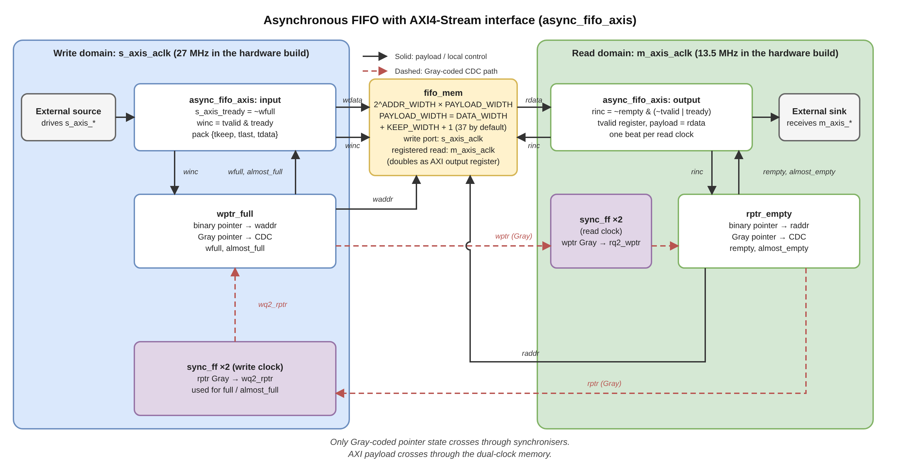
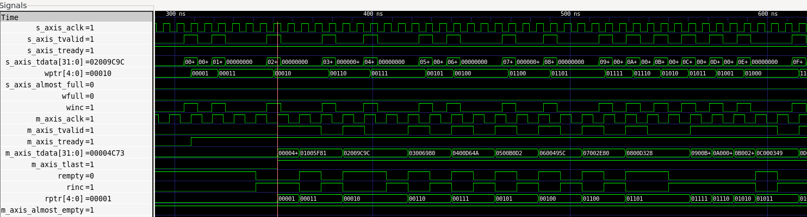
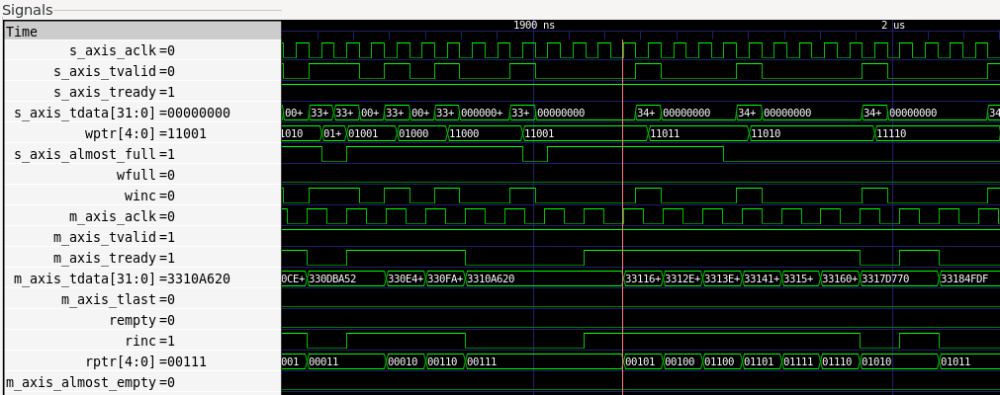
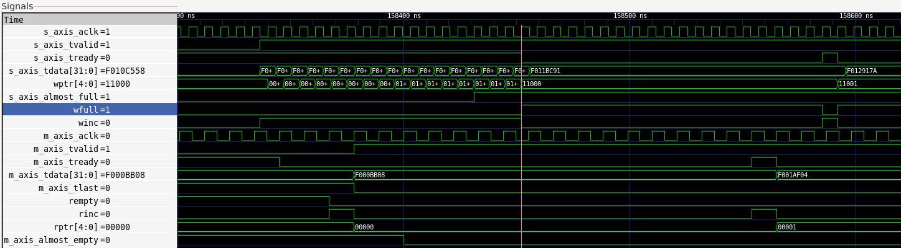
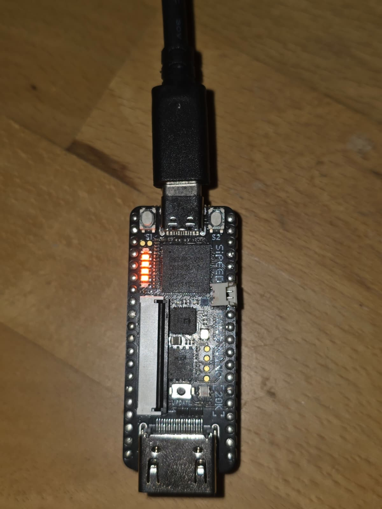

# Asynchronous FIFO with AXI4-Stream

A dual-clock FIFO in Verilog with AXI4-Stream ports on both sides. Verified with a cocotb testbench and ran on a Tang Nano 20K, both as an on-chip self-test (100,000 beats) and as a UART loopback.



## Design

The write and read sides each keep an `ADDR_WIDTH + 1` bit pointer in binary (for addressing) and Gray code (for crossing). Each Gray pointer goes through a two-flop synchroniser into the other domain. Full is detected when the next write pointer matches the synchronised read pointer with its top two bits inverted. Empty is detected when the next read pointer matches the synchronised write pointer. Both flags are registered.

`almost_full` and `almost_empty` are computed from the synchronised pointers. They may lag by a couple of clocks, so they are treated as hints rather than exact counts.

The AXI wrapper stores `{tkeep, tlast, tdata}` (37 bits by default) and sets `s_axis_tready = ~wfull`. The memory's registered read output is used directly as the AXI output register. A new word is read whenever the FIFO has data and the output is empty or being accepted (`rinc = ~rempty & (~m_axis_tvalid | m_axis_tready)`), so the read side delivers one beat per clock. The read register only loads on `rinc`, so the payload stays stable while `TVALID` is high and `TREADY` is low. It holds one beat beyond the 16 in memory, so `rempty` can be 1 while `m_axis_tvalid` is still 1.

| Parameter | Default | |
|---|---|---|
| `DATA_WIDTH` | 32 | `TDATA` width |
| `KEEP_WIDTH` | `DATA_WIDTH/8` | `TKEEP` width |
| `ADDR_WIDTH` | 4 | depth is `2**ADDR_WIDTH` (16) |
| `ALMOST_FULL_VAL` | 12 | |
| `ALMOST_EMPTY_VAL` | 4 | |

## Layout

```
rtl/      FIFO core, AXI wrapper, synchroniser, reset sync, UART
tests/    cocotb testbench, UART loopback script
sim/      Makefile, requirements.txt
fpga/     self-test and UART tops, pins, timing constraints, PLL
docs/     images
```
`fpga/pll/fifo_test_pll.v` is generated by the Gowin IP tool and keeps Gowin’s copyright.


## Simulation

Uses cocotb 2.x and Icarus Verilog.

```bash
pip install -r sim/requirements.txt
cd sim
make                       # seed 12345
RANDOM_SEED=7 make
W_NS=7 R_NS=11 make        # fix the clock periods (ns)
WAVES=1 make               # dump sim_build/async_fifo_axis.fst
```

If `W_NS` and `R_NS` aren't set, the clock periods are picked from the seed (5–17 ns, never equal). The seed and periods are printed at the start of each run, so any failure can be rerun.

The test runs single-beat packets, random-length packets with random backpressure, a fill-to-full-and-drain phase, and 100 packets that wrap the pointers repeatedly. A scoreboard checks every beat, including `TKEEP` and `TLAST`. It also checks:
- the AXI stability rule
- `tready == !wfull`
- that each Gray pointer changes by at most one bit per clock
- that there are no X/Z values

The test fails if full, empty, both almost flags, backpressure on both sides, or partial `TKEEP` never happened.


*Every write accepted. Each beat reaches the output a few read clocks later, and beats that arrive together leave back-to-back.*
 

*While `m_axis_tready` is low the output beat and `rptr` hold. After release, beats leave on consecutive read clocks.*
 

*A burst into an empty FIFO: 16 entries in memory plus one in the output register, then `wfull`. After that, each read frees one write slot.*

RTL simulation does not model metastability or routing skew. It shows the pointer and flag logic works with unrelated clocks, but it cannot prove the crossing is safe on silicon.

## FPGA

Board: Tang Nano 20K (GW2AR-LV18QN88C8/I7). The write side runs on the 27 MHz crystal, and the read side on 13.5 MHz from the rPLL. Both builds use `fpga/uart_fifo.sdc`. `async_fifo_top.v` uses `fifo_constraints.cst` while `uart_fifo_top.v` uses `uart_fifo.cst`
### Self-test (`fpga/async_fifo_top.v`)

A counter writes 100,000 beats at 27 MHz. The read side applies pseudorandom backpressure from an LFSR and checks every beat. The status bits are synchronised back to the LEDs.

| LED | 0 | 1 | 2 | 3 | 4 | 5 |
|---|---|---|---|---|---|---|
| lit when | running | full seen | empty seen | backpressure seen | **pass** | error |


*Finished: LEDs 1–4 lit, 0 and 5 dark.*

### UART loopback (`fpga/uart_fifo_top.v`)

Bytes received at 115200 baud go through the FIFO and are sent back. The transmitter's ready signal drives `m_axis_tready`, so the UART applies real backpressure.

```
pip install pyserial
py tests/test_uart_loopback.py COM5
```


The script sends one byte at a time, so this test checks the datapath and the crossing. The self-test is the one that exercises full and backpressure.

### Results (UART build)

| | |
|---|---|
| Logic | 146 LUT, 6 ALU, 2 SSRAM (164 / 20,736) |
| Registers | 138 / 15,750 |
| Fmax | 203 MHz (27 MHz domain), 192 MHz (13.5 MHz domain) |
| Setup / hold violations | 0 / 0 |

Fmax is Gowin's post-route estimate. The board runs at 27 and 13.5 MHz.

### Timing constraints

The PLL output is related to the input clock, so Gowin times the crossing between the two domains. With no exceptions, that reported about 1 ns of hold failure on the Gray pointers going into the first synchroniser flop.

```
create_clock -name sys_clk -period 37.037 [get_ports {sys_clk}]
create_generated_clock -name clk_13p5 -source [get_ports {sys_clk}] -divide_by 2 [get_pins {Gowin_rPLL_inst/rpll_inst/CLKOUT}]
set_false_path -hold -from [get_clocks {sys_clk}]  -to [get_clocks {clk_13p5}]
set_false_path -hold -from [get_clocks {clk_13p5}] -to [get_clocks {sys_clk}]
```

Only hold is cut. A hold miss into the first synchroniser flop means the bit is captured a cycle later, which the second flop absorbs. Setup is still checked. Because 13.5 MHz is exactly 27/2, the closest launch and capture edges are 37 ns apart in both directions. This keeps each pointer bit's delay, and so the skew between bits, within one clock period, which is what the Gray code relies on. With unrelated clocks, would use a set_max_delay on the pointer paths instead.

The `PR1014` warning comes from the crystal sitting on pin 4, which isn't a global clock pin. The clock still ends up on a global buffer and timing passes.

## Limitations

- `m_axis_tready` feeds `rinc` combinationally, so the read pointer, empty flag and memory read enable all sit      behind the sink's ready. That is fine at 13.5 MHz. At higher clock rates a skid buffer would register it.
- On hardware the clocks come from one crystal (fixed 2:1). Unrelated clocks are only tested in simulation.
- Partial `TKEEP` is only tested in simulation.
- No static CDC tool has been run.

## Author

Chandrakant Chaujer, MEng Electrical and Electronic Engineering, University of Manchester
